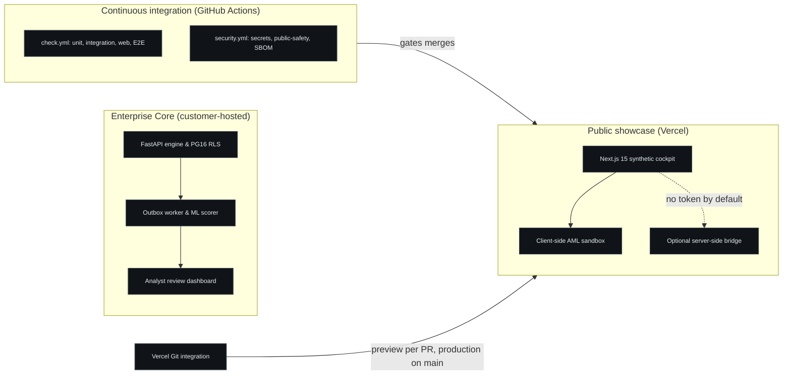
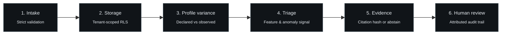
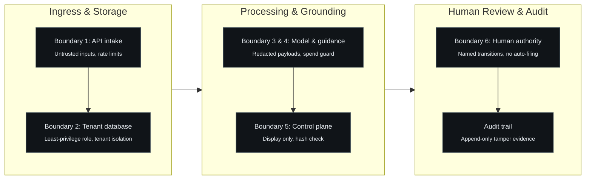

# Public Architecture

This document explains how FinSentinel is designed at a level that is safe for a commercial product to disclose. It is intentionally simplified: it shows components, responsibilities, data flow, and trust boundaries, not the implementation.


## System architecture and delivery

FinSentinel couples a local-first backend engine with a static public showcase. The backend runs in the customer's environment; the showcase is deployed through the Vercel Git integration.



Delivery facts:

- `check.yml` runs the Python unit suite, the integration suite against a disposable PostgreSQL service, and the web gates (typecheck, lint, Vitest, production build, Playwright).
- `security.yml` runs secret scanning, the public-safety verifier, and an SBOM drift check.
- The Vercel Git integration builds a preview for every pull request and deploys production on every push to `main`. There is no deploy workflow in GitHub Actions and no deploy secret in the repository.
- The backend has never been deployed to a cloud account. Terraform exists and validates; it is not applied.

## Component responsibilities

| Component | Responsibility | Public-safe note |
|---|---|---|
| Intake API | Accepts versioned transaction events, enforces strict validation, returns explicit replay/conflict semantics | Contract shape and error policy are described; exact schemas are not published |
| Alert ingestion | Ingests external monitoring alerts idempotently and links them to trigger transactions | Opens cases at model tier; external severity stored as context |
| Identity and tenant checks | Resolves the authenticated principal, membership, and permissions; derives tenant identity server-side | Client-supplied tenant headers are never trusted |
| Enterprise OIDC & sessions | OIDC authorization code flow with PKCE for Microsoft Entra ID, server-side sessions, derived CSRF | Immediate database-checked revocation on every request; tested against a stub IdP only, on an unmerged PR branch |
| Warm-up mode controller | Multi-state cold-start controller (`not_configured`, `warming_up`, `live`) | Scores backfill without opening cases; holds sparse senders |
| Customer policy service | Stores customer-owned AML procedural manuals with database immutability | SHA-256 tamper verification; fail-closed exclusion rules |
| Tenant-scoped storage | Durable system of record for events, processing state, scores, reviews, customer profiles, and audit | Row-level security and split database roles are used; configuration is not published |
| Customer profile service | Stores declared turnover, corridors, CDD refresh date, and customer risk rating; computes variance against observed activity | Variance is a review signal, not a determination; scope and non-goals are published |
| Feature and triage stage | Builds 18 strict prior-event features and produces a triage priority from a versioned, hash-validated artifact | Triage priority is not a fraud probability; thresholds are not published |
| Similar-case retrieval | Finds related historical patterns with a bounded candidate pool and indexed pre-filters | Bounded to keep latency independent of tenant history above the cap |
| Evidence and citation stage | Resolves citations against a versioned synthetic stub registry with content hashes | Weak evidence produces abstention, never a padded citation |
| Draft assembly and case drivers | Produces review-ready material constrained to supplied evidence, plus up to three plain-English reasons | Generated text cannot change a tier or invent a citation; reasons explain, never re-rank |
| Human review | Reviewer claims a case and records an explicit transition with identity and notes | No autonomous final action exists anywhere in the pipeline |
| Audit and export | Append-only audit trail; controlled investigation-pack export (JSON and print HTML) with a SHA-256 digest | Tamper-evidence for reviewers, not administrator-proof immutability |
| Operations tooling | Admin CLI, CSV import, offline licence issuance, tenant export and purge, backup and restore scripts | Operator-only; not exposed as an unauthenticated HTTP surface |
| Automated CI/CD | Runs unit, integration, security, and web gates; the Vercel integration deploys the static showcase | No deploy credentials in GitHub |
| Public showcase | Synthetic cockpit and sandbox at finsentinel-chi.vercel.app | Synthetic by default; an optional server-only bridge can read a local API and always degrades to synthetic |

## Data flow



```text
Synthetic transaction input
    -> validation and identity/tenant checks
    -> tenant-scoped persistence (transaction + audit + outbox row, atomically)
    -> customer profile variance (turnover, corridor, CDD freshness)
    -> asynchronous processing: strict prior-event features -> triage signal
    -> similar-case retrieval (bounded) and synthetic citation lookup
    -> evidence-constrained draft and plain-English case drivers
    -> named human review (clear / escalate / draft)
    -> audit trail and controlled export (JSON + print HTML)
```

Design properties worth noting:

- **Atomic intake.** A new event, its audit record, and its outbox row are written in one transaction. Identical replay and conflicting replay are distinct, explicit outcomes.
- **Asynchronous processing with bounded retries.** Processing failures retry a bounded number of times and then stop in a terminal state; failed items are replayed deliberately, not silently.
- **Deterministic ordering.** A triage tier is fixed after scoring, and no later step (including generated text) can modify it.
- **Abstention as a first-class outcome.** If retrieval is weak or a citation cannot be hash-matched, the pipeline reports insufficient evidence rather than fabricating support.
- **Evidence before prose.** Reasons and draft text are derived from stored features and profile variance; they never introduce a new fact.

Mechanisms behind these properties are described at outcome level on purpose; implementation detail is withheld.

## Trust boundaries



1. **Client to API.** Everything arriving from outside is untrusted input: strict validation, size limits, rate limiting, and permission checks apply. Tenant identity comes from the authenticated principal, never the request body or headers.
2. **API to database.** The runtime uses a least-privilege application role; migrations run under a separate role. Reads and writes are scoped to the authenticated tenant at the database layer, with negative tests for cross-tenant access.
3. **Application to provider.** Outbound payloads are redacted before any external model call, and provider use is disabled by default in the recorded configuration. A spend guard bounds any future provider activity.
4. **Retrieved text to application.** Retrieved text is treated as untrusted data. Injected instructions inside retrieved content cannot become application behaviour; tests assert this.
5. **Generated text to control plane.** Generated prose is display material with a fixed schema. It cannot alter tiers, invent citations, or trigger external action.
6. **System to human.** The review boundary is explicit: a named reviewer performs the state transition. The system has no code path that files, escalates externally, or contacts a regulator.
7. **Public showcase to enterprise core.** The public deployment is synthetic by default. An optional server-side bridge can read a local API when a server-only token is configured: the token never reaches the browser, the upstream call times out, and every failure returns the synthetic fixture with a stated reason. The bridge is not part of the public deployment.

## Human-review boundary


```text
triage -> pending review -> in review -> cleared | escalated | drafted-for-review
```

- High and critical triage outcomes require human review.
- A reviewer claims a case before acting; only the assignee can close it.
- Every transition records the reviewer, the previous and next state, and the time.
- Terminal states have no outgoing transitions; reopening is a deliberate design decision, not an accident.
- Audit history is append-only by database privilege, and the documentation states plainly that a database administrator can still rewrite rows: this is tamper-evidence, not immutability.

## Deployment topology

| Environment | What runs | Evidence |
|---|---|---|
| Local development | Docker Compose: PostgreSQL, API, worker, dashboard | Integration tests, demos, benchmarks |
| Customer-hosted pilot | Docker-only compose file: migrate, API, worker, admin | Pilot smoke check 6/6, offline licence, CSV import |
| Static showcase | Next.js static export on Vercel | Live at finsentinel-chi.vercel.app |
| Cloud backend | Terraform definition only | `terraform validate` passes; never applied |

## Deliberately omitted

This public architecture intentionally excludes:

- source code for any product workflow;
- prompts, agent instructions, and tool schemas;
- database schemas, exact validation rules, and configuration values;
- scoring features, thresholds, calibration data, and model artifacts;
- retrieval implementation, ranking logic, and evidence-selection heuristics;
- infrastructure specifics: hosts, networks, account identifiers, bucket or queue names;
- security control configuration beyond what is necessary to explain the design;
- evaluation fixtures and internal evidence files.

The omission list is part of the design: the case study demonstrates engineering judgement, while the implementation recipe stays private.

See [DECISIONS.md](DECISIONS.md) for the public-safe decision notes behind these choices.
