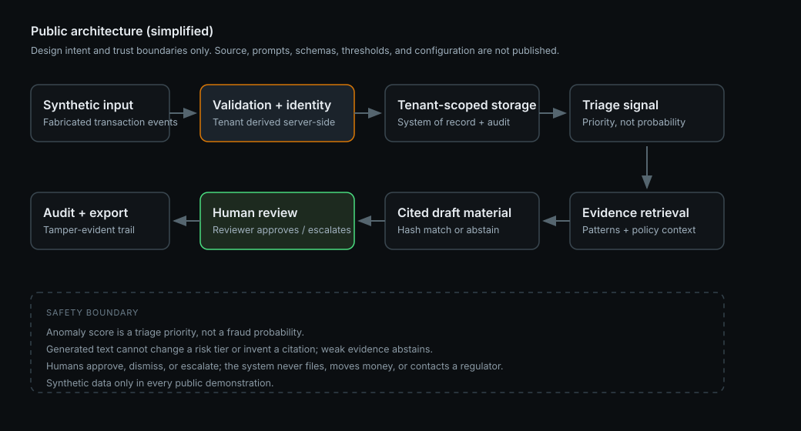
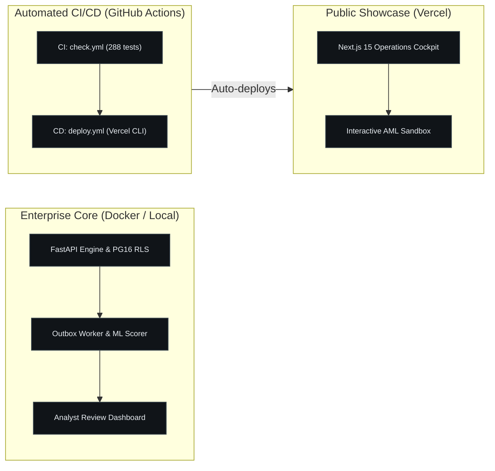
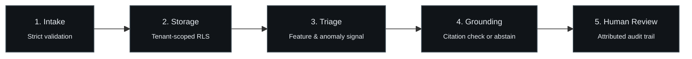
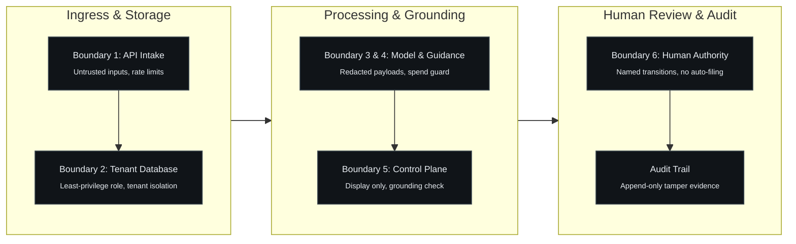
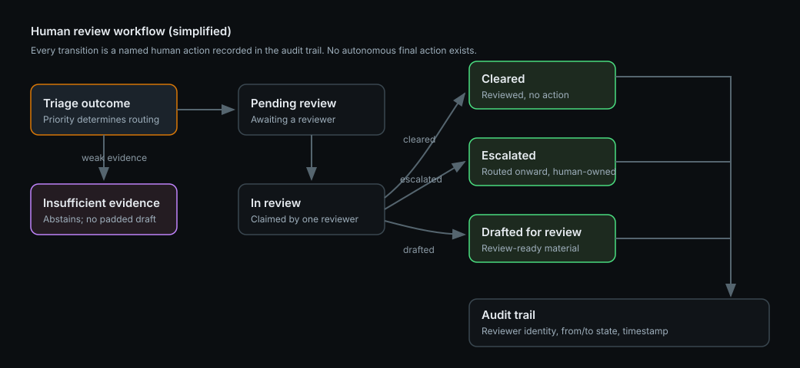

# Public Architecture

This document explains how FinSentinel is designed at a level that is safe for a commercial product to disclose. It is intentionally simplified: it shows components, responsibilities, data flow, and trust boundaries, not the implementation.



## System architecture and delivery

FinSentinel couples a local-first enterprise backend engine with a client-side public showcase deployed to Vercel's edge network via automated CI/CD:



## Component responsibilities

| Component | Responsibility | Public-safe note |
|---|---|---|
| Intake API | Accepts versioned transaction events, enforces strict validation, returns explicit replay/conflict semantics | Contract shape and error policy are described; exact schemas are not published |
| Identity and tenant checks | Resolves the authenticated principal, membership, and permissions; derives tenant identity server-side | Client-supplied tenant headers are never trusted |
| Tenant-scoped storage | Durable system of record for events, processing state, scores, reviews, and audit | Row-level security and split database roles are used; configuration is not published |
| Feature and triage stage | Builds history-based features and produces a triage priority from a versioned scoring artifact | Triage priority is not a fraud probability; thresholds are not published |
| Evidence and retrieval stage | Finds related historical patterns and retrieves cited guidance chunks with provenance | Weak evidence produces abstention, never a padded citation |
| Draft assembly | Produces review-ready investigation material constrained to supplied evidence | Generated text cannot change a risk tier or invent a citation |
| Human review | Reviewer claims a case and records an explicit transition with identity and notes | No autonomous final action exists anywhere in the pipeline |
| Audit and export | Append-only audit trail; controlled investigation-pack export (JSON and print HTML) | Tamper-evidence for reviewers, not administrator-proof immutability |
| Automated CI/CD | Runs unit, integration, and typecheck gates on commit; deploys public showcase on main | GitHub Actions executes check.yml and deploy.yml with Vercel CLI |
| Public Edge Showcase | Client-side sandbox and operations cockpit hosted at finsentinel-chi.vercel.app | Air-gapped from backend core; executes purely in browser with mock synthetic data |

## Data flow



```text
Synthetic transaction input
    -> validation and identity/tenant checks
    -> tenant-scoped persistence (transaction + audit + processing queue entry, atomically)
    -> asynchronous processing: features -> triage signal
    -> similar-case retrieval and cited regulatory guidance
    -> cited draft investigation material
    -> named human review (approve / dismiss / escalate / draft)
    -> audit trail and controlled export
```

Design properties worth noting:

- **Atomic intake.** A new event, its audit record, and its processing-queue entry are written in one transaction. Identical replay and conflicting replay are distinct, explicit outcomes.
- **Asynchronous processing with bounded retries.** Processing failures retry a bounded number of times and then stop in a terminal state; failed items are replayed deliberately, not silently.
- **Deterministic ordering.** A triage tier is fixed after scoring, and no later step (including generated text) can modify it.
- **Abstention as a first-class outcome.** If retrieval is weak or citations cannot be grounded, the pipeline reports insufficient evidence rather than fabricating support.

Mechanisms behind these properties are described at outcome level on purpose; implementation detail is withheld.

## Trust boundaries



1. **Client to API.** Everything arriving from outside is untrusted input: strict validation, size limits, rate limiting, and permission checks apply. Tenant identity comes from the authenticated principal, never the request body or headers.
2. **API to database.** The runtime uses a least-privilege application role; migrations run under a separate role. Reads and writes are scoped to the authenticated tenant at the database layer, with negative tests for cross-tenant access.
3. **Application to provider.** Outbound payloads are redacted before any external model call, and provider use is disabled by default in the recorded configuration. A spend guard bounds any future provider activity.
4. **Retrieved text to application.** Retrieved regulatory text is treated as untrusted data. Injected instructions inside retrieved content cannot become application behaviour; tests assert this.
5. **Generated text to control plane.** Generated prose is display material with a fixed schema. It cannot alter tiers, invent citations, or trigger external action.
6. **System to human.** The review boundary is explicit: a named reviewer performs the state transition. The system has no code path that files, escalates externally, or contacts a regulator.
7. **Public edge showcase to enterprise core.** The public showcase is hosted on Vercel's edge network and runs entirely within the visitor's browser with synthetic data. It has no network route, API keys, or database access into the enterprise core, maintaining an air gap between public demonstration and private systems.

## Human-review boundary



```text
triage -> pending review -> in review -> cleared | escalated | drafted-for-review
```

- High and high-critical triage outcomes require human review.
- Every transition records the reviewer, the previous and next state, and the time.
- Terminal states have no outgoing transitions; reopening is a deliberate design decision, not an accident.
- Audit history is append-only by database privilege, and the documentation states plainly that a database administrator can still rewrite rows: this is tamper-evidence, not immutability.

## Deliberately omitted

This public architecture intentionally excludes:

- source code for any product workflow;
- prompts, agent instructions, and tool schemas;
- database schemas, exact validation rules, and configuration values;
- scoring features, thresholds, calibration data, and model artifacts;
- retrieval implementation, ranking logic, and evidence-selection heuristics;
- infrastructure specifics: hosts, networks, account identifiers, bucket or queue names;
- security control configuration beyond what is necessary to explain the design;
- evaluation fixtures and internal evidence files.

The omission list is part of the design: the case study demonstrates engineering judgement, while the implementation recipe stays private.
