# Evaluation

## Evaluation goals

1. Prove the pipeline works end-to-end on synthetic data: ingest, process, profile variance, triage, retrieve evidence, draft, review, and export.
2. Record reproducible, attributable measurements for latency, throughput, and citation mechanics instead of adjectives.
3. Keep evaluation honest: every published number states its dataset, date, gate, run type, and limitations.
4. Make the evaluation itself a safety boundary: figures that cannot meet this standard are withheld.

## Dataset description

- Synthetic transactions generated by a seeded, deterministic generator with annotated typologies and look-alike normal cases.
- The end-to-end benchmark uses a 100-event synthetic ingestion run for the 2026-10-20 measurement, and a 50-event run for the earlier 2026-10-07 record.
- The pilot-pack evaluation uses 10 synthetic cases across triage bands, exercising pack preparation, citation hash verification, and abstention.
- The *pilot kit* is an internal evaluation package prepared for prospective customer pilots. No pilot has been run, and no customer has used the product.
- Citations in the recorded gates come from a small versioned synthetic stub registry with content hashes; it is not a regulatory corpus.
- **No real customer data, real alerts, or production records were used anywhere.** All data is synthetic.

```mermaid
flowchart LR
    subgraph DataGen["1. Synthetic generation"]
        direction TB
        G1["100-event benchmark"]
        G2["10 pilot cases"]
        G3["Synthetic stub registry"]
    end

    subgraph Harness["2. Measurement harness"]
        direction TB
        H1["Ingest p50: 28.62 ms"]
        H2["Scoring p50: 6.27 ms"]
        H3["Pack p50: 43.86 ms"]
    end

    subgraph Gates["3. Verification gates"]
        direction TB
        V1["404 unit + 95 integration"]
        V2["Citation hash verification: 1.0"]
        V3["Spend: $0.00 (mock mode)"]
    end

    DataGen --> Harness --> Gates

    classDef box fill:#101418,stroke:#3a4750,color:#e8edf2,font-size:11px;
    class G1,G2,G3,H1,H2,H3,V1,V2,V3 box;
```

## Metrics and definitions

| Metric | Definition |
|---|---|
| Unit / integration tests | Counts reported by the project test runner at the recorded gate, including parameterised cases |
| Web tests | Vitest route tests run by the web toolchain, and Playwright E2E tests against a production build |
| Ingestion throughput | Accepted events per second through the REST intake on a warm local stack |
| Consumer scoring | Milliseconds per event to compute features and produce a score in the background processing path |
| Workflow execution | Mean milliseconds per event for the full five-node processing pipeline |
| Dashboard p50 | Median response time of the analyst dashboard overview query |
| Pack preparation p50 | Median milliseconds to build an exportable investigation pack for a high-priority case |
| Citation hash verification | Fraction of citations in generated drafts that match a versioned synthetic stub by content hash (verified / total). Not a measure of legal applicability or regulatory grounding |
| Provider spend | USD actually charged by external model providers during the gate |

## Evidence tiers

Every quoted result is labelled with an evidence tier:

| Tier | Meaning | Current use |
|---|---|---|
| E0 | Design intent, not executed | Architecture and threat-model statements |
| E1 | Synthetic or mock execution, non-transferable | All current model, latency and citation evidence |
| E2 | Authorised labelled data, executed protocol | None yet |
| E3 | Independent external validation | None yet |

The model evaluation protocol that defines the path from E1 to E2 is pre-registered in the private repository. It is described at a public-safe level in [LIMITATIONS.md](LIMITATIONS.md).

## Verified results

All results below are from a single Apple Silicon macOS development machine running the local stack in mock-only mode. They describe the synthetic test setup and do **not** predict real-world fraud-detection performance.

### 1. Test suite (2026-10-22)

- **Value:** 434 unit tests, 106 integration tests, 7 Playwright E2E tests, and 5 Vitest tests passing.
- **Dataset scope:** synthetic fixtures, disposable test databases, and a production web build.
- **Test date:** 2026-10-22.
- **Identifier:** post-acceptance local verification and web gate; internal commits omitted (source repository is private).
- **Run type:** local, synthetic.
- **Limitations:** a green local suite is not production proof, uptime, or a substitute for independent security testing. Counts grow over time; the 2026-10-21 record was 404 unit / 95 integration, the 2026-10-17 record was 288 unit / 86 integration, and the 2026-10-12 pilot-kit gate was 285 / 86.

### 2. Pipeline benchmark (2026-10-20)

Source record: the project's dated latency evidence for 2026-10-20. Machine: Apple Silicon macOS, 10 CPU cores, Python 3.12, local PostgreSQL 16 container.

| Metric | Value |
|---|---|
| Synthetic events | 100 |
| Ingestion p50 | 28.62 ms (p95 31.61 ms) |
| Consumer scoring p50 | 6.27 ms per event |
| Ingestion throughput | 137.3 events/second |
| Dashboard overview p50 | 27.56 ms |
| Pack assembly p50 | 43.86 ms |
| Pack assembly p95 / p99 | 45.51 ms / 53.25 ms |
| Provider spend | $0.00 (mock provider) |

- **Dataset scope:** 100 synthetic ingestion events and 50 synthetic packs at a tenant volume of roughly 2,000 transactions.
- **Test date:** 2026-10-20.
- **Identifier:** post-acceptance performance sweep; internal commits omitted.
- **Run type:** local, mock-only, synthetic.
- **Limitations:** single machine, no concurrent load, no network latency, no provider calls. The pack benchmark fails if p95 reaches 60 ms, so the number is guarded rather than cherry-picked. Above 1,000 prior rows, retrieval selects candidates through indexed pre-filters rather than scanning the full tenant history.

The earlier 2026-10-07 P7 record measured 36.13 requests/second, 6.49 ms/event consumer scoring, 13.12 ms/event for the five-node chain, and 27.97 ms dashboard p50. It is retained for comparison and is not the current number.

### 3. Pilot pack evaluation (2026-10-20)

Source record: the project's dated 10-case pilot-pack evaluation.

| Metric | Value |
|---|---|
| Cases | 10 synthetic |
| Cases with packs prepared | 7 |
| Cases abstained | 3 |
| Pack preparation p50 | 76.7 ms |
| Pack preparation max | 79.5 ms |
| Citation hash verification | 1.0 (every citation matched a versioned stub hash) |
| Provider spend | $0.00 (mock provider) |

- **Dataset scope:** 10 synthetic cases across triage bands in a local stack.
- **Test date:** 2026-10-20.
- **Identifier:** P9 pilot-pack evaluation re-run; internal commits omitted.
- **Run type:** local, mock-only, synthetic.
- **Limitations:** the verification figure covers 7 cited cases against a synthetic stub registry; the 3 abstentions show abstention working, not evidence of detection quality. The older 2026-10-09 record measured p50 177.5 ms and marked the target unmet; a later re-run measured 243.7 ms. The performance defect behind that variance is described in the README.

### 4. Internal release checks (2026-10-12 / 2026-10-21)

- **Value:** the one-command pilot smoke check passed 6/6; the release preflight verifier passed 4/4 checks (environment posture, secret scan, licence, schema chain); the public-safety verifier passed on the documentation set.
- **Dataset scope:** local synthetic environment.
- **Test date:** pilot-kit gate (2026-10-12) and the 2026-10-21 verification.
- **Identifier:** pilot-kit and re-verification records; internal commits omitted.
- **Run type:** local, synthetic.
- **Limitations:** these are project-specific scripted checks, not an external audit, penetration test, or certification.

## Superseded figures

These numbers appear in earlier public revisions and are kept only so a reader can reconcile them. They are not current.

| Figure | Earlier value | Current value |
|---|---|---|
| Unit / integration tests | 288 / 86 (2026-10-17) | 404 / 95 (2026-10-21) |
| Pack assembly p50 | 177.5 ms (2026-10-09), 243.7 ms (2026-10-17) | 43.86 ms (2026-10-20) |
| Ingestion throughput | 36.13 req/s (2026-10-07) | 137.3 events/s (2026-10-20) |
| Model feature count | 14 | 18 |
| Citation metric name | citation grounding | citation hash verification |
| Delivery | `deploy.yml` via Vercel CLI | Vercel Git integration; `check.yml` is CI only |

## Withheld results

The following were considered for publication and deliberately withheld:

| Item | Reason |
|---|---|
| Simulated per-case time saving | The underlying evidence record labels the figure as assumption-based and simulated, not measured. Publishing any number would risk being read as real productivity data |
| Synthetic anomaly-evaluation figures (look-alike flag rates, contamination calibration) | They describe generator labels, not detection quality; any public wording risks being mistaken for fraud-detection accuracy |
| Triage thresholds and scoring calibration values | Product internals; publishing them would disclose the implementation recipe |
| Cloud cost model estimates | Modelled, not incurred; deployment was never performed |

These items are recorded with provenance in a private review report outside this repository and can be promoted later if the author approves specific wording.

## Reproducibility limits

- Measurements come from one personal macOS machine, not a controlled benchmark environment.
- The stack is local (containers on one host); no network, multi-tenant load, or production-like conditions were exercised.
- Evaluation datasets are small and synthetic, generated deterministically but not independently reproducible by third parties because the generator is private.
- Run-to-run variance is real and shown where two runs exist.
- No third party has reproduced these results.

## Synthetic-data disclaimer

Every number in this document comes from synthetic or mock runs on a local machine. None of it is evidence of real-world AML detection, prevention, or regulatory performance. Anomaly scores are triage priorities, not fraud probabilities.

## Funding and cost statement

All recorded gates ran with paid provider access disabled and a mock provider. Provider spend at every gate was $0.00. The cloud backend was never deployed; infrastructure was written and statically validated only. The static showcase is hosted on Vercel.
