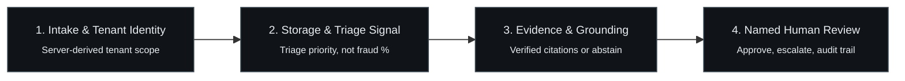
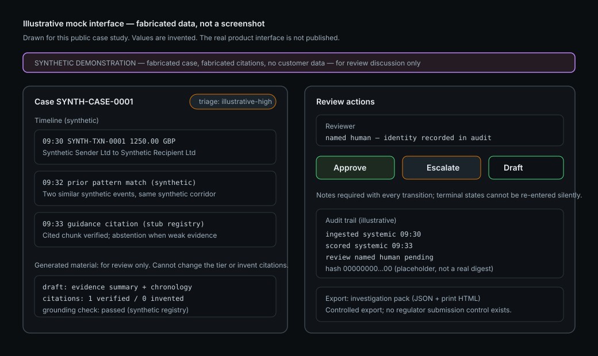

# FinSentinel: Evidence-Backed AML Investigation Workflows

A public engineering case study for a private compliance-AI product prototype.

> FinSentinel is a private commercial product. This repository contains public-safe documentation, synthetic examples, and high-level architecture only. It does not contain the product source code, customer data, credentials, private prompts, or operational configuration.
>
> All published results come from synthetic or mock data on a local development machine. Nothing here is a claim of real-world fraud-detection performance or regulatory compliance. See [EVALUATION.md](EVALUATION.md) and [LIMITATIONS.md](LIMITATIONS.md).

## 1. One-minute overview

- **The problem.** AML alert investigation is largely assembly work. An analyst has to pull together transaction history, related events, prior similar cases, regulatory guidance, and supporting evidence, then write a case file a reviewer can sign off on. That work is slow, repetitive, and easy to do inconsistently.
- **What FinSentinel assembles.** A tenant-scoped pipeline that ingests transaction events, validates them, computes history-based features, produces a triage priority, retrieves related evidence and cited guidance, and drafts an investigation case file with the evidence attached.
- **Who reviews the result.** A named human reviewer. The system assists the investigation workflow; it does not decide outcomes.
- **What stays human-controlled.** Whether a case is cleared, escalated, or drafted further. The system cannot file regulatory reports, move money, or contact a regulator.
- **What this public repository contains.** The engineering narrative: architecture, safety boundaries, evaluation design with provenance, threat model, limitations, synthetic examples, public-safe diagrams, and the validation script that keeps this repository honest. It does not contain the implementation.

Terms used throughout: a *triage priority* orders review work rather than estimating fraud probability; *abstention* means the system declines to answer when evidence is weak; an *investigation pack* is the exportable case file a reviewer checks.

Read next: [ARCHITECTURE.md](ARCHITECTURE.md) · [EVALUATION.md](EVALUATION.md) · [THREAT-MODEL.md](THREAT-MODEL.md) · [LIMITATIONS.md](LIMITATIONS.md) · [DISCLOSURE.md](DISCLOSURE.md)

## 2. Problem and design goal

Compliance teams investigating an alert may need to assemble, from several sources:

- chronological transaction history for the parties involved;
- related events and prior similar cases;
- supporting evidence with provenance;
- relevant regulatory guidance, cited rather than paraphrased;
- a reviewable case file with a full audit trail.

The design goal is to reduce that assembly work while preserving what a regulated workflow cannot give up: human review, provenance, auditability, and controlled escalation. Every generated element is grounded in supplied evidence; weak evidence produces abstention rather than a padded answer.

This is a hypothesis about a useful workflow. It is not a claim that the product replaces an AML program, proves criminal conduct, or files a report.

## 3. What I built

FinSentinel is a single-maintainer project. I directed scope, phase gates, and acceptance, and I built and documented the system in a private repository. The private repository records work including:

- designed transaction validation and ingestion boundaries, including strict money, timestamp, and reference handling;
- implemented tenant-scoped persistence and access controls, with server-derived tenant identity rather than client-supplied headers;
- built the feature and triage path, separating triage priority from any claim of fraud probability;
- built the evidence retrieval and citation-grounding path, including abstention when evidence is weak;
- assembled the investigation workflow as an explicit multi-step pipeline with failure and replay semantics;
- added human-review lifecycle states, reviewer identity, and an append-only audit trail;
- created synthetic evaluation harnesses and a release preflight check;
- authored the threat model, operational limitations, and phase-by-phase evidence records.

## 4. Public architecture

The public architecture is documented in [ARCHITECTURE.md](ARCHITECTURE.md) and illustrated below:


### End-to-end processing pipeline



The generic data flow:

```text
Synthetic transaction input
    -> validation and identity/tenant checks
    -> tenant-scoped persistence
    -> features and triage signal
    -> similar-case/evidence retrieval
    -> cited draft investigation material
    -> named human review
    -> audit trail and controlled export
```

### Human-in-the-loop review lifecycle

Every state transition is a named human decision recorded in the append-only audit trail. The system assists investigation preparation; humans decide outcomes.


The public diagrams are intentionally simplified. They communicate system intent, safety guarantees, and trust boundaries without disclosing proprietary implementation details. See [ARCHITECTURE.md](ARCHITECTURE.md) for full component specifications.

## 5. Safety boundary

- Synthetic data only in the public demonstration.
- The anomaly score is a triage priority, not a fraud probability.
- Generated text cannot change a risk tier or invent a citation.
- Humans approve, dismiss, or escalate cases; every transition is attributed.
- The system does not file regulatory reports, move money, or contact a regulator.
- The product is not a substitute for legal, compliance, or MLRO judgment.

## 6. Evaluation evidence

[EVALUATION.md](EVALUATION.md) lists every published metric with its value, dataset scope, test date, a phase-gate identifier, and whether the run is synthetic, local, mock, or live. Internal commit identifiers are deliberately omitted because the source repository is private.

Highlights from the recorded gates (all local, synthetic, mock-mode):

- 288 unit tests and 86 integration tests passing at the 2026-10-17 re-verification;
- ~36 requests/second ingestion and ~6.5 ms/event scoring in a 50-event synthetic benchmark (2026-10-07);
- dashboard overview p50 ~28 ms in the same benchmark;
- investigation-pack preparation p50 177.5 ms across 10 synthetic pilot-pack cases (2026-10-09; the recorded internal target was unmet at that gate, and a 2026-10-17 re-run measured 243.7 ms);
- $0.00 provider spend, because paid provider calls are disabled and a mock provider is used.

These results describe the synthetic test setup and do not predict real-world fraud-detection performance. Metrics the private records cannot support at this standard are withheld and listed in [EVALUATION.md](EVALUATION.md).

## 7. Threat model

[THREAT-MODEL.md](THREAT-MODEL.md) describes the assets the design protects (tenant data, evidence integrity, audit trail, credentials), the trust boundaries, high-level threats, mitigations at a safe level of detail, and residual risks that remain open. It intentionally excludes exploit detail, private findings, and exact security controls that would increase attackability in the real product.

## 8. Product status

- A private commercial product prototype, developed as a personal project.
- This public repository is a documentation case study only.
- The demonstration is synthetic; no real customer data has been processed.
- The product source is not released here and no production deployment is claimed.
- No customers, pilots, revenue, or market validation exist yet.
- No legal, regulatory, or compliance certification is claimed or implied.

## 9. Screenshots and demonstration

No private dashboard screenshots are published. The poster below is an illustrative mock UI poster drawn for this public case study: it contains invented values, is labelled as illustrative, and is not a capture of the product.



A live interactive client-side showcase is accessible at [https://finsentinel-chi.vercel.app](https://finsentinel-chi.vercel.app). It runs in pure client-side mock mode with synthetic data and does not connect to private backend systems.

Fully synthetic machine-readable examples live in [examples/](examples/synthetic-transaction.json): a transaction record, a case summary with evidence references, and a benchmark summary with provenance.

## 10. Technical stack

Stack disclosed at a category level (safe to publish):

- **Language and API:** Python 3.12, FastAPI, Pydantic.
- **Data:** PostgreSQL 16 (pgvector-capable image; vector retrieval is not wired yet), SQLAlchemy, Alembic migrations.
- **Orchestration:** LangGraph-based multi-step workflow with checkpointing.
- **Scoring:** scikit-learn classical anomaly scoring over versioned history-based features.
- **Evaluation and quality:** pytest (unit, integration, contract, concurrency, replay, citation, and injection tests), Ruff, a documentation-claims gate.
- **Delivery:** Docker Compose local stack, Terraform infrastructure-as-code definition (validated, never deployed), CI checks.
- **Web showcase:** Next.js 15 / React 19 static landing page with a client-side-only interactive sandbox hosted at [https://finsentinel-chi.vercel.app](https://finsentinel-chi.vercel.app).

Exact configuration, prompts, schemas, thresholds, and operational details are not published.

## 11. Interview discussion points

1. **Human-in-the-loop safety design.** How review states, reviewer identity, and append-only audit make “assist” different from “automatic”, and where the boundary is enforced in the pipeline.
2. **Tenant isolation and authorization.** Why tenant identity is server-derived, how cross-tenant access is tested against, and why a client-supplied tenant header is never authorization.
3. **Evidence grounding and abstention.** How drafts are constrained to supplied evidence, why an invented citation fails the request closed, and when the system prefers to abstain.
4. **Synthetic evaluation limits.** What the benchmarks do and do not show, why simulated time-savings were withheld from this repository, and how provenance is recorded per metric.
5. **Replay, idempotency, and operational resilience.** Duplicate-vs-conflict semantics, retry and terminal-failure behaviour in the processing queue, and crash/restart handling.

## 12. Contact and links

- GitHub: [github.com/jeevesh2515](https://github.com/jeevesh2515)
- Live interactive showcase: [https://finsentinel-chi.vercel.app](https://finsentinel-chi.vercel.app)
- Professional inquiries: via the author's GitHub profile.

Never linked from here: private repositories, internal dashboards, deployment URLs, or confidential documents.

---

This repository's documentation is covered by [DOCUMENTATION-LICENSE.md](DOCUMENTATION-LICENSE.md) (CC BY-NC-ND 4.0). The product implementation is not licensed here. See [OWNERSHIP-AND-LICENSE.md](OWNERSHIP-AND-LICENSE.md) and [DISCLOSURE.md](DISCLOSURE.md).
