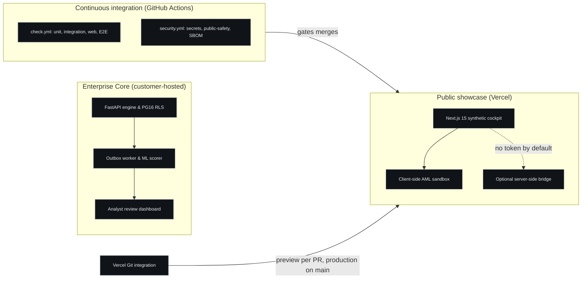
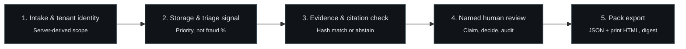

# FinSentinel: Evidence-Backed AML Investigation Workflows

A public engineering case study for a private compliance-AI product prototype.

> FinSentinel is a private commercial product. This repository contains public-safe documentation, synthetic examples, and high-level architecture only. It does not contain the product source code, customer data, credentials, private prompts, or operational configuration.
>
> All published results come from synthetic or mock data on a local development machine. Nothing here is a claim of real-world fraud-detection performance or regulatory compliance. See [EVALUATION.md](EVALUATION.md) and [LIMITATIONS.md](LIMITATIONS.md).

## Review this in five minutes

1. [One-minute overview](#1-one-minute-overview) — what it does and who decides.
2. [Public architecture](#4-public-architecture) — five stages, one human gate.
3. [Two bugs worth discussing](#7-two-bugs-worth-discussing) — the honest engineering.
4. [What the numbers do and do not show](#6-evaluation-evidence).
5. [What I would build next](#9-known-gaps-and-what-i-would-build-next).

The long version follows. [ARCHITECTURE.md](ARCHITECTURE.md) covers design, [EVALUATION.md](EVALUATION.md) covers evidence, [LIMITATIONS.md](LIMITATIONS.md) covers what is missing.

## 1. One-minute overview

- **The problem.** AML alert investigation is largely assembly work. An analyst pulls transaction history, customer context, prior similar cases, policy references and supporting evidence into one file, then writes a narrative a reviewer can sign. That work is slow, repetitive, and inconsistent between analysts.
- **What FinSentinel assembles.** A tenant-scoped pipeline that ingests transaction events, validates them, computes strict prior-event features, produces a deterministic triage priority, retrieves related evidence and synthetic citation stubs, calculates customer-profile variances, drafts an investigation file, and exports a reviewable pack with a digest.
- **Who reviews the result.** A named human reviewer. The system assists the investigation workflow; it does not decide outcomes.
- **What stays human-controlled.** Whether a case is cleared, escalated, or drafted further. The system has no code path that files a regulatory report, moves money, or contacts a regulator.
- **What this public repository contains.** The engineering narrative: architecture, safety boundaries, evaluation design with provenance, threat model, limitations, synthetic examples, public-safe diagrams, and the validation script that keeps this repository honest. It does not contain the implementation.

Terms used throughout: a *triage priority* orders review work rather than estimating fraud probability; *abstention* means the system declines to answer when evidence is weak; an *investigation pack* is the exportable case file a reviewer checks.

## 2. Problem and design goal

Compliance teams investigating an alert may need to assemble, from several systems:

- chronological transaction history for the parties involved;
- related events and prior similar cases;
- customer KYC/CDD context and variance against the declared profile;
- supporting evidence with provenance;
- relevant policy context, cited rather than paraphrased;
- a reviewable case file with a full audit trail.

Generative tooling can draft faster, but a regulated workflow cannot accept unattributed prose, invented citations, or a machine-made disposition. The design goal is therefore narrower than "automate AML": reduce the assembly work while preserving human review, provenance, auditability, and controlled escalation.

Every generated element is constrained to supplied evidence. Weak evidence produces abstention rather than a padded answer. This is a hypothesis about a useful workflow, not a claim that the product replaces an AML programme, proves criminal conduct, or files a report.

## 3. What I built

FinSentinel is a single-maintainer project. I directed scope, phase gates, and acceptance, and I built and documented the system in a private repository. The private repository records work including:

- designed transaction validation and ingestion boundaries, including strict money, timestamp, and reference handling, with replay `200` versus conflict `409` semantics;
- implemented tenant-scoped persistence and access controls, with server-derived tenant identity rather than client-supplied headers, PostgreSQL row-level security, and negative cross-tenant tests;
- built a transactional outbox with a runnable consumer daemon: bounded retries, terminal failure, explicit replay, and fail-closed model artifact loading;
- built the feature and triage path, including an 18-feature vector (strict prior-event history features with a no-lookahead proof, plus transaction intrinsics), and kept triage priority separate from any claim of fraud probability;
- added a customer risk profile and variance engine: declared turnover, corridor mismatches, CDD staleness, and a customer risk rating, all tenant-scoped and audited;
- built the evidence and citation path, including abstention when evidence is weak, and renamed the public metric to citation *hash verification* to avoid implying regulatory grounding;
- assembled the investigation workflow as an explicit five-node pipeline with failure and replay semantics;
- added human-review lifecycle states, reviewer identity, row-level locking, an append-only audit trail, and plain-English case drivers that explain a case without changing its tier;
- created synthetic evaluation harnesses, a 10-case pilot-pack evaluation, a release preflight check, and a fail-closed public-safety validator for documentation;
- built an offline HMAC licensing path, a tenant export/purge lifecycle, an admin CLI, CSV import, and a customer-hosted pilot kit;
- authored the threat model, operational limitations, a pre-registered model evaluation protocol, and phase-by-phase evidence records.

## 4. Public architecture

The public architecture is documented in [ARCHITECTURE.md](ARCHITECTURE.md) and illustrated below:


### System architecture and delivery

FinSentinel couples a local-first backend engine with a static public showcase deployed through the Vercel Git integration:



### End-to-end processing pipeline



The generic data flow:

```text
Synthetic transaction input
    -> validation and identity/tenant checks
    -> tenant-scoped persistence (transaction + audit + outbox row, atomically)
    -> customer profile variance (turnover, corridor, CDD freshness)
    -> strict prior-event features and a deterministic triage priority
    -> similar-case retrieval (bounded candidate pool) and synthetic citation lookup
    -> evidence-constrained draft with plain-English case drivers
    -> named human review (clear / escalate / draft)
    -> audit trail and controlled investigation-pack export
```

### Human-in-the-loop review lifecycle

Every state transition is a named human decision recorded in the append-only audit trail. Only the assignee can close a case; terminal states have no outgoing transitions.


The public diagrams are intentionally simplified. They communicate system intent, safety guarantees, and trust boundaries without disclosing proprietary implementation details.

## 5. Safety boundary

- Synthetic data only in the public demonstration.
- The anomaly score is a triage priority, not a fraud probability.
- Tiers are fixed after scoring: generated text cannot change a risk tier or invent a citation.
- Citations resolve to a versioned synthetic stub registry, not to regulator text.
- Humans approve, dismiss, or escalate cases; every transition is attributed.
- The system does not file regulatory reports, move money, or contact a regulator.
- The product is not a substitute for legal, compliance, or MLRO judgement.

## 6. Evaluation evidence

[EVALUATION.md](EVALUATION.md) lists every published metric with its value, dataset scope, test date, a gate identifier, and whether the run is synthetic, local, mock, or live. Internal commit identifiers are deliberately omitted because the source repository is private.

Current recorded gates (all local, synthetic, mock-mode):

- **404 unit tests + 95 integration tests + 4 Playwright E2E + 3 Vitest route tests** passing on 2026-10-21;
- **ingest p50 28.62 ms**, **scoring p50 6.27 ms at 137.3 events/s**, and **dashboard p50 27.56 ms** in a 100-event benchmark on 2026-10-20;
- **investigation-pack assembly p50 43.86 ms, p95 45.51 ms, p99 53.25 ms** across 50 synthetic packs, with a CI-adjacent benchmark that fails if pack p95 reaches 60 ms;
- the 10-case pilot harness measured **p50 76.7 ms** and met its target; the older 177.5 ms figure is historical;
- **$0.00 provider spend**, because paid provider calls are disabled and a mock provider is used.

These results describe the synthetic test setup and do not predict real-world fraud-detection performance. Metrics the private records cannot support at this standard are withheld and listed in [EVALUATION.md](EVALUATION.md).

## 7. Two bugs worth discussing

Portfolio case studies usually show the finished system. The two defects below are more informative than the feature list. Both were found by me on 2026-10-20 during an end-to-end audit of the private repository, and both passed every existing test before they were found. The evidence pointers name records in the private repository; they are listed so a reviewer can ask for them in an interview.

### 7.1 The O(n²) retrieval defect

| Step | What happened |
| --- | --- |
| **Problem** | Investigation-pack assembly took **1,070 ms p50** at a synthetic tenant of 582 transactions, while scoring a single event took single-digit milliseconds. The pack is on the path of every case a reviewer opens. |
| **How it was found** | A latency benchmark across ingest, scoring and pack assembly. The pack number was out of line with every other stage, so I read the similar-case retrieval step it calls. |
| **Root cause** | The ranking function standardised each feature against the candidate pool, but recomputed the pool mean and standard deviation once per candidate per feature. Cost grew with the square of tenant history. Results were correct, so correctness tests could not see it. |
| **Fix** | Compute the pool statistics once and reuse them, which leaves every distance numerically identical. Then bound the pool: above 1,000 prior rows, indexed sender and channel pre-filters pick at most 1,000 candidates before features are computed, so cost no longer grows with tenant volume. |
| **Regression lock** | One test asserts distances still equal the original per-candidate formula; one ranks 2,000 candidates under a time ceiling; an integration test pins the 1,000-row cap; the pack benchmark fails if p95 reaches 60 ms. |
| **Result** | Pack assembly **1,070 ms to ~52 ms p50** at the same 582-transaction tenant after the hoist. After bounding, the 50-pack benchmark records **43.86 ms p50 / 45.51 ms p95**. Synthetic data, one local machine. |

Evidence: the private production-readiness review of 2026-10-20 (section 2.3), the retrieval unit tests, and the latency benchmark records listed in [EVALUATION.md](EVALUATION.md).

### 7.2 The cold-start feature defect

| Step | What happened |
| --- | --- |
| **Problem** | Under feature set `p3-features-v1`, every sender with no prior history scored **HIGH (0.6429)**, however ordinary the payment. An ordinary first payment and a suspicious one landed in the same queue position. |
| **How it was found** | Building a one-command demo with an "ordinary baseline" scenario. The baseline case kept arriving as HIGH, and only seeding 30 days of prior history moved it. |
| **Root cause** | The v1 vector held 15 values: 12 prior-history features (velocity counts, sums, mean, z-score, counterparty and corridor flags, inter-arrival time) and 3 missingness flags. It had nothing about the transaction itself. With no history, every cold-start event produced the same vector, so it got the same score. |
| **Fix** | `p3-features-v2` adds three transaction-intrinsic features: `account_age_days` (clipped to 10 years and scaled to 0–1), `is_cash_channel`, and `log_amount` (log10 of 1 + amount / 1,000). The 3 missingness flags were already in v1 and are unchanged. Total: 18 features. The synthetic generator gained cash channels and a cold-start cohort, and the model was retrained with a new versioned artifact. |
| **Regression lock** | A feature-contract test pins the version and the 18-feature order. Five cold-start tests run the committed model: an ordinary first-time domestic payment and an ordinary first cash payment must stay below HIGH; a cash structuring burst and a sudden international spike must stay HIGH or above. |
| **Result** | Ordinary first-time domestic payment **MEDIUM 0.3982**; ordinary first cash payment **MEDIUM 0.5374**; cash structuring burst and international spike **CRITICAL 1.0000**. These are triage priorities on synthetic data. The model remains a synthetic baseline, not a validated detector. |

Evidence: the private feature module and its version history, the cold-start and feature-contract test files, and the production-readiness review of 2026-10-20.

## 8. Threat model

[THREAT-MODEL.md](THREAT-MODEL.md) describes the assets the design protects (tenant data, evidence integrity, audit trail, credentials), the trust boundaries, high-level threats, mitigations at a safe level of detail, and residual risks that remain open. It intentionally excludes exploit detail, private findings, and exact security controls that would increase attackability in the real product.

The honest residual list includes: audit is tamper-evident but a database administrator can rewrite rows; workflow resume position is in-process; provider spend control is single-process; there has been no external penetration test; and the public showcase has an optional bridge that is disabled without a server-only token.

## 9. Known gaps and what I would build next

These are the gaps I would close before asking a compliance team to pay for the product. They are listed here because a case study that only shows strengths is not useful to a reviewer.

| # | Gap | Status | What closing it means |
| --- | --- | --- | --- |
| 1 | **Alert ingestion** | In progress (2026-10-22) | Accept alerts from the customer's existing monitoring system and open a case for the primary trigger transaction. Idempotent per tenant, source system and external alert id. The case tier stays FinSentinel's deterministic model tier; the external severity is stored as context only. If the trigger transaction is not scored yet, the alert waits and the case opens when scoring completes. This is the difference between "a second detector" and "a workflow layer". |
| 2 | **SSO and user administration** | Gap | OIDC login, MFA, role assignment, revocation, and an audit of admin actions. Bearer tokens and a CLI are fine for a demo, not for procurement. |
| 3 | **Audit integrity beyond application privilege** | Gap | Hash chaining and an export path to a SIEM or WORM store, so "append-only" is not only a database privilege claim. |
| 4 | **Data lifecycle completeness** | Gap | Tenant export and purge must cover customer profiles as well as transactions, scores, reviews and audit rows. |
| 5 | **External validation** | Gap | A penetration test, a paper trail for the threat model, and the pre-registered model evaluation on authorised labelled data. Until then, all model evidence is synthetic and non-transferable. |
| 6 | **Durable workflow and spend state** | Gap | Workflow resume position and provider spend control are in-process today; both need shared, durable state before more than one worker runs. |

Public-safe decision notes are in [DECISIONS.md](DECISIONS.md).

## 10. Product status

- A private commercial product prototype, developed as a personal project.
- This public repository is a documentation case study only.
- The demonstration is synthetic; no real customer data has been processed.
- The product source is not released here. The static showcase is live; the backend has never been deployed to a cloud account.
- No customers, pilots, revenue, or market validation exist yet.
- No legal, regulatory, or compliance certification is claimed or implied.

## 11. Screenshots and demonstration

The poster below is an illustrative mock UI drawing for this public case study: it contains invented values, is labelled as illustrative, and is not a capture of the product.


A live interactive client-side showcase is available at [https://finsentinel-chi.vercel.app](https://finsentinel-chi.vercel.app). It operates on synthetic data with no connection to a private backend by default. Key capabilities:

- **AML operations cockpit:** a Next.js 15 / React 19 review surface with triage rows, customer-profile variance badges, and a human-gate indicator.
- **Synthetic citation registry:** three versioned stubs with source id and hash status. No coverage percentage and no regulator-alignment claim.
- **Structuring topology:** an HTML5 canvas view of branch deposits funnelling into a flagged mule account, used as a visual explanation of the typology.
- **Client-side digests:** Web Crypto SHA-256 for the demonstration case digest, with a copy fallback.
- **Synthetic AML sandbox:** interactive scenario loading that shows triage priority shifts and pack export on generated payloads.
- **Optional live bridge:** a server-only route can read a local API if a token is configured; every failure degrades to the synthetic demo. It is not part of the public deployment.

Fully synthetic machine-readable examples live in [examples/synthetic-transaction.json](examples/synthetic-transaction.json): a transaction record, a case summary with evidence references, and a benchmark summary with provenance.

## 12. Technical stack

Stack disclosed at a category level (safe to publish):

- **Language and API:** Python 3.12, FastAPI, Pydantic.
- **Data:** PostgreSQL 16 with row-level security, SQLAlchemy, six Alembic migrations. Retrieval uses deterministic token overlap plus indexed SQL pre-filters, not vector search.
- **Orchestration:** LangGraph 0.6.11 five-node workflow with in-process checkpointing.
- **Scoring:** scikit-learn IsolationForest over 18 versioned features, with a committed artifact manifest and SHA-256 validation.
- **Evaluation and quality:** pytest (unit, integration, contract, concurrency, replay, citation, cold-start and injection tests), Ruff, Vitest, Playwright, a documentation-claims gate, and a public-safety validator.
- **Delivery:** Docker Compose local stack and a customer-hosted pilot compose file; GitHub Actions `check.yml` and `security.yml`; Vercel Git integration for the static showcase (preview per pull request, production on `main`); Terraform infrastructure-as-code validated but never deployed.
- **Web showcase:** Next.js 15 / React 19 / Tailwind v4, light and dark themes, 130 kB First Load JS, 4 Playwright E2E and 3 Vitest route tests.

Exact configuration, prompts, schemas, thresholds, and operational details are not published.

## 13. Interview discussion points

1. **Human-in-the-loop safety design.** How review states, reviewer identity, row locking, and append-only audit make "assist" different from "automatic", and where the boundary is enforced.
2. **Tenant isolation and authorization.** Why tenant identity is server-derived, how RLS and split database roles work together, and why a client-supplied tenant header is never authorization.
3. **Evidence grounding and abstention.** How drafts are constrained to supplied evidence, why an invented citation fails the request closed, and when the system prefers to abstain.
4. **Synthetic evaluation limits.** What the benchmarks do and do not show, why the model claim is deliberately narrow, and how evidence tiers prevent a synthetic result from becoming a capability claim.
5. **Replay, idempotency, and operational resilience.** Duplicate-versus-conflict semantics, bounded retries, terminal failure, and crash/restart handling.
6. **Finding and fixing a real performance defect.** The O(n²) ranking bug, how correctness tests hid it, and how the fix was measured and regression-locked.
7. **Data lifecycle.** What a tenant export contains, what purge deletes, and where the current implementation still falls short.

## 14. Contact and links

- GitHub: [github.com/jeevesh2515](https://github.com/jeevesh2515)
- Live synthetic showcase: [https://finsentinel-chi.vercel.app](https://finsentinel-chi.vercel.app)
- Professional inquiries: via the author's GitHub profile.

Never linked from here: private repositories, internal dashboards, deployment URLs, or confidential documents.

---

This repository's documentation is covered by [DOCUMENTATION-LICENSE.md](DOCUMENTATION-LICENSE.md) (CC BY-NC-ND 4.0). The product implementation is not licensed here. See [OWNERSHIP-AND-LICENSE.md](OWNERSHIP-AND-LICENSE.md) and [DISCLOSURE.md](DISCLOSURE.md).
