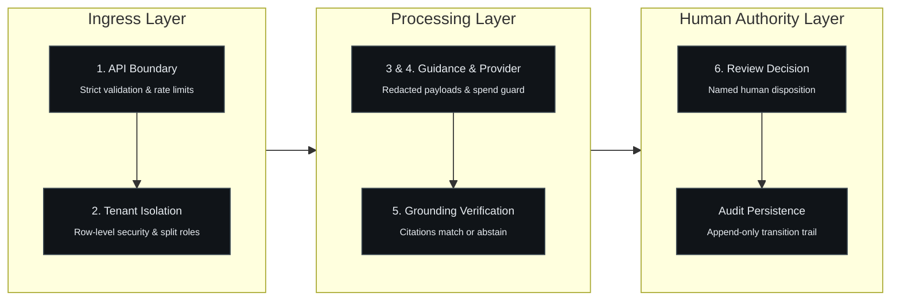

# Public Threat Model

This is a public-safe summary of the security thinking behind FinSentinel. It is written to show judgement, not configuration. It deliberately excludes exploit detail, private findings, and control configuration.

## Assets being protected

1. **Tenant data.** Transaction records and everything derived from them belong to exactly one tenant; leakage across tenants is the highest-severity failure.
2. **Evidence integrity.** Retrieved guidance, citations, and case evidence must be traceable to their source; a fabricated or mismatched citation corrupts the investigation record.
3. **The audit trail.** Who reviewed what, when, and with what outcome must survive attempts to quietly rewrite history.
4. **Risk-tier integrity.** The machine triage tier must be stable: nothing downstream, especially generated text, may change it.
5. **Credentials.** Authentication material must never appear in source, logs, examples, or generated output.
6. **Availability of processing.** A defective event or repeated provider failure must not be able to stall the pipeline indefinitely.

## Trust boundaries

- **Client to API**: all external input is untrusted; strict validation, authentication, authorization, rate limits.
- **API to database**: runtime uses a least-privilege role; migrations use a separate role; tenant scope is enforced at the data layer.
- **Application to external provider**: outbound content is redacted first; provider usage is disabled by default and bounded by a spend guard when enabled.
- **Retrieved text to application**: retrieved regulatory text is untrusted input and is treated as data, never instructions.
- **Generated text to control plane**: generated prose cannot mutate state, tiers, or citations.
- **System to human**: disposition and escalation are human transitions, recorded with reviewer identity.
- **Public edge showcase to enterprise core**: the public deployment serves synthetic fixture data by default. An optional server-side bridge can read a local API when a server-only token is configured. The token never reaches the browser, the upstream call times out, and every failure returns synthetic data with an explicit reason. The bridge is disabled in the public deployment and is not a public data path.

## High-level threats and design responses

| Threat class | Public-safe design response |
|---|---|
| Spoofing identity | Credential material is never stored or logged in recoverable form; tenant identity is derived from the authenticated principal, never from client input |
| Tampering with case data | Risk tiers are immutable after scoring; review transitions follow an explicit state machine; exported records carry tamper-evidence markers |
| Repudiation of review actions | Every transition appends an audit record with reviewer identity, states, and timestamp; anonymous transitions are impossible by construction |
| Information disclosure across tenants | Tenant scope is enforced at the data layer for reads and writes; isolation failures do not reveal the existence of other tenants' records; outbound payloads are redacted before any provider call |
| Denial of service and runaway cost | Rate limiting on public entry points; bounded retries with terminal failure states; provider spend bounded by a reservation guard before any call; no unbounded result sets |
| Elevation of privilege | Read and write permissions checked per route; the review state machine is the only path between statuses; terminal states have no out-edges |
| Prompt injection via retrieved content | Deterministic tier primacy; citations must match verified sources or the request fails closed; injected instructions in retrieved text cannot become application behaviour |
| Unsupported regulatory claims | Grounding validation: a draft referencing an unknown or mismatched citation is rejected rather than shown; weak evidence produces abstention |
| Exposure of private core via public demo | Synthetic-by-default delivery: the public showcase serves fixture data unless an operator configures a server-only bridge; no bearer token is exposed to the browser and every bridge failure degrades to synthetic data |

## Residual risks (honest list)

1. **Administrator access.** Audit records are append-only by application privilege, but a database administrator can rewrite rows. The design provides tamper-evidence, not immutability. External anchoring is undecided.
2. **Restart resilience.** Workflow resume position does not currently survive a process restart; durable processing effects are idempotent, which bounds the impact. Durable checkpointing is future work.
3. **Regulatory retrieval is demonstrative.** The recorded gates use a small synthetic stub registry rather than a complete, verified regulatory corpus; retrieved text is illustrative, not a legal reference.
4. **Provider spend control is single-process.** It does not survive restart or span instances. Paid provider access is disabled in the recorded configuration, so the current blast radius is zero.
5. **Local identity scope.** The recorded configuration uses a local identity model suitable for a loopback demonstration. Production identity (OIDC, MFA), transport security, and internet-facing abuse controls are separate scopes with their own review.
6. **No independent security testing.** The threat model is a design audit backed by the project's own tests. There has been no external penetration test or code audit.
7. **Audit integrity limit.** Append-only is enforced by database privilege, not by a hash chain or WORM storage. A database administrator with sufficient rights can rewrite rows. Hash chaining and an external export path are planned, not shipped.
8. **Optional bridge configuration.** The public showcase bridge is safe only while no token is configured or the token remains server-side. A misconfiguration that exposes a token or widens the upstream timeout changes the risk posture and must be reviewed before enabling it for any customer-facing use.

## Excluded from this document

- exploit techniques, attack payloads, and reproduction steps;
- private security findings and their remediation history;
- exact control values, thresholds, and configuration;
- internal service names, hosts, and infrastructure identifiers.

See [LIMITATIONS.md](LIMITATIONS.md) for product-level limits and [DISCLOSURE.md](DISCLOSURE.md) for what this repository is and is not.
